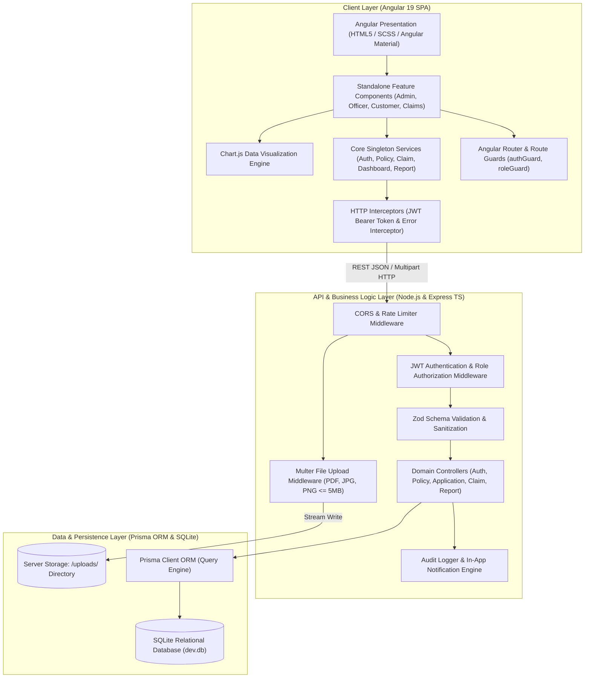

# System Architecture Diagram

The Insurance Claims & Policy Management Portal follows a 3-tier enterprise client-server architectural pattern, strictly separating presentation, business logic, and relational persistence.

## Architectural Highlights
1. **Separation of Concerns:** Business rules (e.g. claim amount <= coverage limit, valid dates) are enforced both on the client via Angular Reactive Forms and authoritatively on the backend via Zod and Prisma queries.
2. **Stateless JWT Security:** Authentication is completely stateless; the client stores the signed token and transmits it in the `Authorization: Bearer <token>` header, verified on each protected backend route.
3. **Dedicated Physical Storage:** Binary document files (medical invoices, police FIRs, accident photos) are stored on disk in the `uploads/` folder with cryptographically randomized unique filenames, while metadata and claim relationships reside in SQLite.

