# Angular Component Hierarchy & Architecture

The Angular 19 frontend is engineered utilizing **standalone components**, unified routing with view transitions, reactive signals, and clean layered separation between presentation, core logic, and shared contracts.

```mermaid
flowchart TD
    AppRoot["AppComponent (app-root)"]
    RouterOutletMain["Router Outlet"]
    MainLayout["MainLayoutComponent (app-main-layout)"]
    
    Navbar["NavbarComponent (app-navbar)\n- Real-time unread badge\n- User profile menu\n- Mobile sidebar toggle"]
    Sidebar["SidebarComponent (app-sidebar)\n- Role-specific dynamic navigation\n- Quick status links"]
    ContentOutlet["Content Router Outlet (<router-outlet>)"]

    AppRoot --> RouterOutletMain
    RouterOutletMain --> MainLayout
    MainLayout --> Navbar
    MainLayout --> Sidebar
    MainLayout --> ContentOutlet

    %% Feature Routed Views
    ContentOutlet --> Landing["LandingComponent ('/')"]
    ContentOutlet --> Login["LoginComponent ('/auth/login')"]
    ContentOutlet --> Register["RegisterComponent ('/auth/register')"]
    
    subgraph CustomerViews ["Customer Feature Module"]
        CustDash["CustomerDashboardComponent ('/customer/dashboard')"]
        MyPol["MyPoliciesComponent ('/my-policies')"]
        SubmitClaim["ClaimSubmitComponent ('/claims/submit')"]
    end

    subgraph OfficerViews ["Insurance Officer Feature Module"]
        OffDash["OfficerDashboardComponent ('/officer/dashboard')"]
    end

    subgraph AdminViews ["Administrator Feature Module"]
        AdminDash["AdminDashboardComponent ('/admin/dashboard')\n- 4 Chart.js Canvases"]
        AdminPol["AdminPoliciesComponent ('/admin/policies')"]
        AdminApp["AdminApplicationsComponent ('/admin/applications')"]
        AdminUser["UserManagementComponent ('/admin/users')"]
        AuditView["AuditLogsComponent ('/admin/audit-logs')"]
    end

    subgraph SharedViews ["Cross-Cutting Operations"]
        PolList["PolicyListComponent ('/policies')"]
        PolDetail["PolicyDetailComponent ('/policies/:id')"]
        PolApply["PolicyApplyComponent ('/policies/:id/apply')"]
        ClaimList["ClaimListComponent ('/claims')"]
        ClaimDetail["ClaimDetailComponent ('/claims/:id')\n- Evidence Viewer\n- Audit Timeline"]
        Reports["ReportsComponent ('/reports')\n- Multi-filter & CSV Export"]
        Notifs["NotificationsComponent ('/notifications')"]
        Profile["ProfileComponent ('/profile')"]
        NotFound["NotFoundComponent ('404')"]
    end

    ContentOutlet --> CustDash
    ContentOutlet --> MyPol
    ContentOutlet --> SubmitClaim
    ContentOutlet --> OffDash
    ContentOutlet --> AdminDash
    ContentOutlet --> AdminPol
    ContentOutlet --> AdminApp
    ContentOutlet --> AdminUser
    ContentOutlet --> AuditView
    ContentOutlet --> PolList
    ContentOutlet --> PolDetail
    ContentOutlet --> PolApply
    ContentOutlet --> ClaimList
    ContentOutlet --> ClaimDetail
    ContentOutlet --> Reports
    ContentOutlet --> Notifs
    ContentOutlet --> Profile
    ContentOutlet --> NotFound
```

## Layered Services and Cross-Cutting Concerns
- **Authentication & Guards:** `AuthService`, `authGuard`, `roleGuard`.
- **HTTP Interceptors:** `jwtInterceptor` (attaches Bearer token), `errorInterceptor` (handles 401s).
- **Core Domain Services:** `PolicyService`, `ClaimService`, `ApplicationService`, `CustomerPolicyService`, `DashboardService`, `NotificationService`, `ReportService`, `UserService`.
- **State Management:** Angular Signals (`signal<User | null>`, `signal<number>`, `computed<boolean>`).

