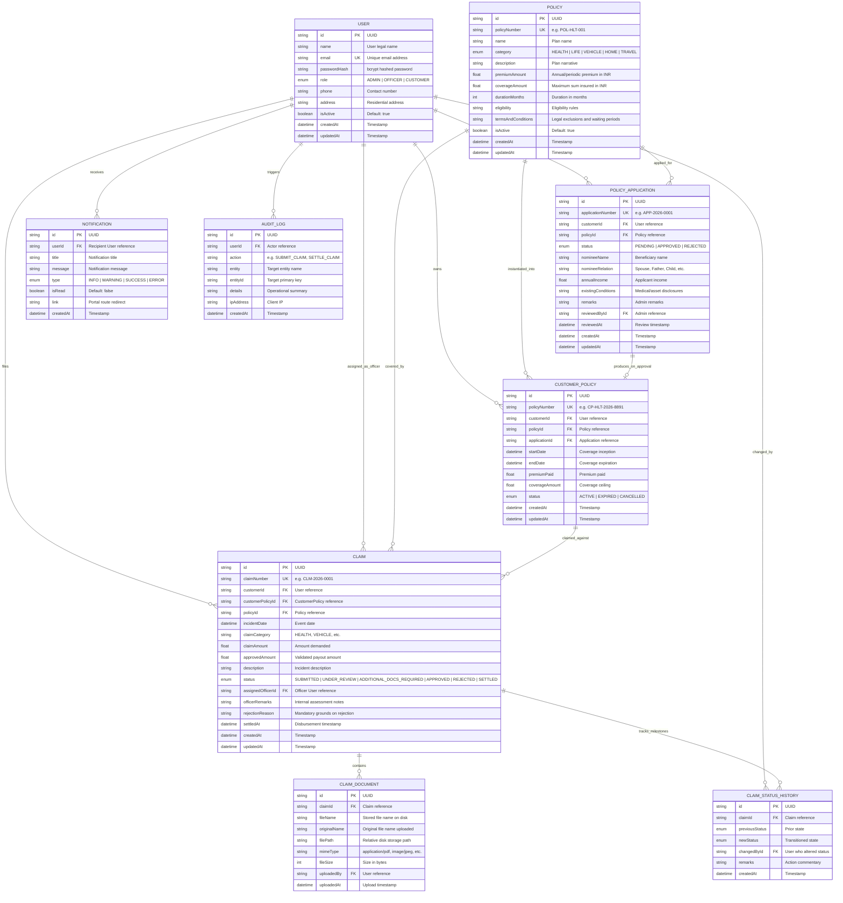

# Database Entity-Relationship (ER) Diagram

The Insurance Claims & Policy Management Portal database is normalized to Third Normal Form (3NF) and implemented using **Prisma ORM** with **SQLite**.

