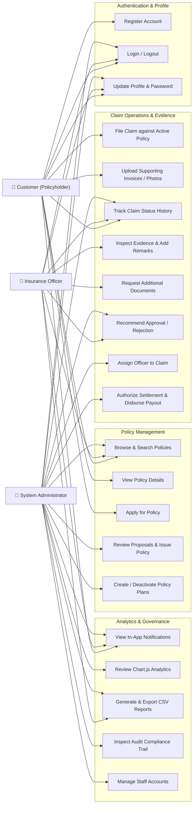

# Use-Case Diagram

The use-case model delineates the interactions between the three primary actors—**Customer**, **Insurance Officer**, and **Administrator**—and the core capabilities of the portal.

