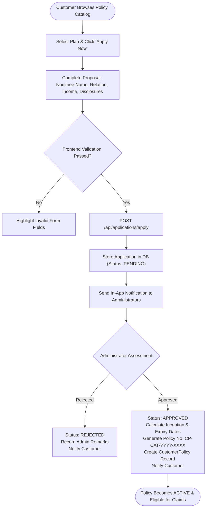
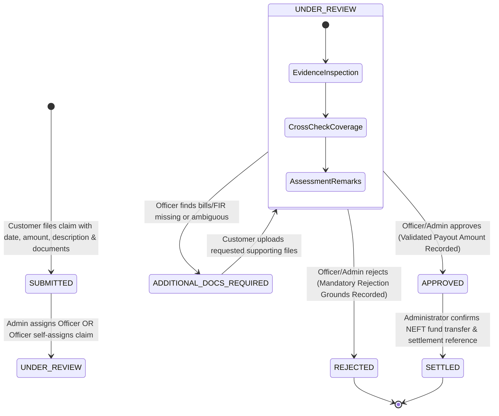

# Workflow Diagram

This document illustrates the two critical business workflows of the portal:
1. **Policy Application & Issuance Workflow**
2. **The 6-Stage Insurance Claims & Settlement Lifecycle**

---

## 1. Policy Application & Issuance Workflow

---

## 2. 6-Stage Insurance Claim & Settlement Lifecycle

## Business Rules & Validation Checkpoints
1. **Active Policy Validation:** Claims cannot be submitted against policies with status `EXPIRED` or `CANCELLED`.
2. **Date Boundaries:** $\text{StartDate} \le \text{IncidentDate} \le \text{CurrentDate} \le \text{EndDate}$.
3. **Financial Limit:** $\text{ClaimAmount} \le \text{PolicyCoverageAmount}$.
4. **Duplicate Prevention:** No two non-rejected claims can exist for the same policy on the same incident date.
5. **Rejection Justification:** Every status change to `REJECTED` strictly requires a populated `rejectionReason`.
6. **Settlement Prerequisite:** A claim must hold status `APPROVED` prior to transitioning to `SETTLED`.

